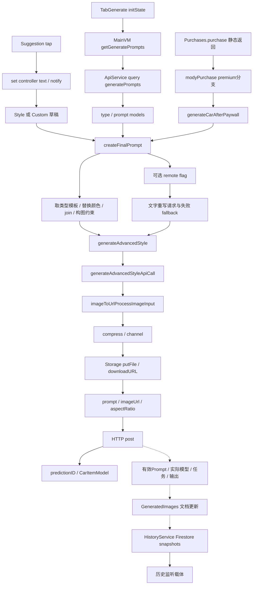
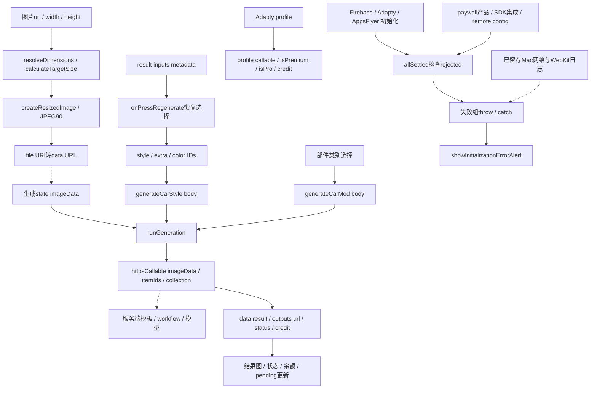

# 业务链与界面行为：哪些连接真实可读

本页把客户端调用、请求schema与录像记录对照。实线表示选定代码调用或寄存器/字段数据流；虚线表示尚未取得的服务端处理或运行联系。实线也不表示本轮实际执行；Hermes 的 closure/generator 连接是构造与环境追踪，不应误报为直接 Call 指令。[AOT05–AOT23、MFY02–MFY12]

## Mody：Prompt、图片、购买与历史

模板、建议及 Prompt：AOT05–AOT12。图片/API：AOT13–AOT15。历史订阅：AOT23。购买回调：AOT22。虚线服务端部分：QUALITY_UNKNOWN_MODY。图中的压缩/上传表示所查分支存在；缓存命中等路径可能直接返回 URL，不能说每次全部经过。购买箭头也不确认交易已被Apple/服务端接受。

工具分支另有实证：Flux命名请求→`flux2edit` 别名、PImage命名请求→`pimageedit`、Workflow请求→`workFlowId`、Topaz命名请求→`topazupscale`。公开只用别名，完整内部host/config留私有；模型/provider字段不能凭名称补齐。[AOT16–AOT19]

## Modyfy：选项 ID、图像与通用初始化错误

图片代码及参数：MFY07–MFY09。CarStyle / CarMod→request / response：MFY02–MFY05。再次编辑、权益：MFY06、MFY10。初始化到弹窗：MFY11–MFY12；Mac日志的因果联系仍虚线，MFY13。导入到所有标准生成入口的覆盖、实际上传字节、服务器任务状态与模型没有运行证据。

`generateCarStyle` 等29字节 wrapper 只是 `apply` 包装；沿工厂/环境/生成器找到主体，不能把同一个重复wrapper地址当完整实现。#20350→#20351→#20352，嵌套runGeneration #20353→#20354→#20355；CarMod 对应#20361/#20364。本轮未运行JS字节码。[MFY01–MFY04]

## UI ↔ 代码 ↔ 实际证据

| 用户行为 | 录像二手记录 | 本轮静态关联 | 可确认；未知 |
|---|---|---|---|
| Mody Style Builder | 00:20–00:22 Style / Extra / Color，UX05 | type/prompt远程模型→createFinalPrompt，AOT06–AOT09 | 有结构化模板编排；当次选项如何实际执行未知 |
| Mody Custom Edit | 00:42、01:35–01:41，UX09 | 草稿文字、可选Gpt分支、共用generate主干，AOT05、AOT10–AOT12 | 不只是UI文案；remote开关/服务端有效Prompt未知 |
| Mody Detail Edit | 同一录屏第三tab未证实，UX46 | handler清理/目标模板/轮胎remote workflow，AOT20、AOT25 | 有局部意图代码分支；不是mask或固定模型证明 |
| Mody点击Generate | 01:18–01:22等待，UX15 | 常规图片/API路径，AOT13–AOT15 | 客户端能够构造请求；不能绑定为录像中已发生上传/开工 |
| Mody购买CTA | 约01:30 Apple价面板，UX17 | Purchases→modyPurchase→afterPaywall分支，AOT22 | 静态购买回调可触发生成；真实扣款/校验/成功未观察 |
| Mody保存/历史 | 当次空车库，UX07/UX18 | snapshots/history载体，AOT23 | 列表服务可读；server写入/实际保存未完整证明 |
| Modyfy Style/Extra/Color | 01:02–01:24四步，UX28–UX30 | 选项ID数组＋collection＋imageData，MFY02–MFY05 | 客户端意图schema明确；完整Prompt在服务端未知 |
| Modyfy Car Mods/Effects | 01:26–01:49多类入口，UX31/UX32 | CarMod /通用response路径，MFY04–MFY05 | 类别业务分支可见；不同模型/精准安装未知 |
| Modyfy选择/Replace | 00:56–01:00，UX27 | resize/data URL helper及导入引用，MFY07–MFY09 | 编码规则可查；不能反推录像当次图像已上传 |
| Modyfy订阅/试用 | 00:34–00:37，UX23 | Adapty/profile/credit，MFY10 | 权益载体有代码；更高质量/更多模型无证据 |
| Modyfy再编辑 | 录屏未见成功结果，UX42 | inputs recipe恢复，MFY06 | 可恢复输入；版本保真、保存与再次生成效果未知 |
| Modyfy Mac启动失败 | 用户报告通用弹窗 | #6708 catch→#6623 alert，MFY11–MFY13 | 通用路径已关联；具体依赖与根因仍未知 |

两次“看到等待/付款面板”不能组成生成成功链。静态同名App安装版也不能补证视频版本、冷启动状态、套餐或耗时。Modyfy当次首周付费报价不能推广到所有地区/用户。[UX17、UX23、UX39–UX44]

## 对 FORM 的具体意义

把同一份 server plan 同时用于确认摘要和模型请求，原始input、Prompt/template/profile与output有出处，能真正定位质量差异。选项ID便于服务器更新模板，但也要求版本冻结；不能让等待页和费用摘要读取当前变化的remote配置。已生成recipe用于重进编辑可借鉴，实际基础图和observed内容仍须可信确认。[FORM23–FORM29、MFY03、MFY06]

FORM当前运行入口仍是legacy，F01参考Prompt/任务/质量模块与F02 schema不能冒充已接线V2；F03已有CODE_READY但迁移独立审核仍待完成。本研究图不是实施指令，不改变F00–F38依赖。[FORM02–FORM09、FORM41；详见05/06]
