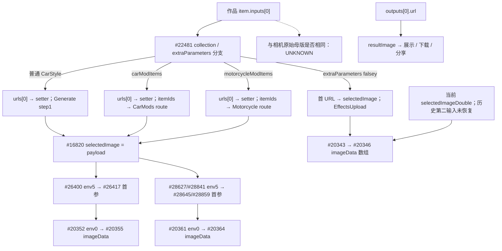

# FORM｜本机客户端定点追踪结论（2026-10-14）

本轮完成四项能由现有本地材料解决的静态追踪。Modyfy 的内置名称→ID→请求、Regenerate 的下一次输入值、Mody 的组合分支和 Wrapr 的分类→参数→请求均有新增代码证据。Mody 新 Tires 控件仍有未解回调边；服务器 Prompt、模型、兼容性和实际效果均为 **UNKNOWN**。未运行竞品、未调用模型、未购买或上传私人素材。

基线为 PR #8 `07ed7aefa5be96ca363edaa5883a4e51671ba2d2`；既有 PR #7 的 228 条账本保持原样。本报告只讲新追踪。安装版本和原件哈希见 [输入索引](LOCAL_TRACE_INPUTS.json)，每个结论的地址、字段和限制见 [证据索引](LOCAL_TRACE_EVIDENCE.json)，跨应用映射见 [实际矩阵](ACTUAL_LOCAL_TRACE_MATRIX.csv)。所有确定结论为 `CLIENT_CODE_LINKED`，表示同版本静态关联；本轮没有 `UI_OBSERVED` 或 `RUNTIME_OBSERVED`。

## 1. Modyfy：具体名称、单选、默认与请求位置

目标为 `com.ai.car.app` **1.2.0 build71 / Hermes96**。`#20804 @0x008ece41` 的 `IOS_HOME_DATA_CACHE.generateItems` 含 28 Style、12 Extra、38 Color。它在 `#20334` 的错误回退分支进入 `setHomeData`；成功分支以 `response.data.data` 替换目录。因此下面是**同版本内置回退目录的确定映射**，当前在线目录仍 UNKNOWN。

| 名称 | 实际 ID | 请求位置 | #20804 相对 PC / HASM 行 |
|---|---|---|---|
| Japanese | `Styles_Japanese` | `itemIds[0]` | `+0x1141` / 808715 |
| Stance | `Styles_Stance` | `itemIds[0]` | `+0x1205` / 808743 |
| Futuristic | `Styles_Futuristic` | `itemIds[0]` | `+0x1133` / 808713 |
| Body Kit | `Extra_BodyKit` | `itemIds[1]` | `+0x1265` / 808758 |
| Spoiler | `Extra_Spoiler` | `itemIds[1]` | `+0x12f1` / 808778 |
| Golden Accents | `Extra_GoldenAccents` | `itemIds[1]` | `+0x129d` / 808766 |
| Golden Accents 1 | `Extra_GoldenAccents-1` | `itemIds[1]` | `+0x12ab` / 808768 |

这不是把旧录像名称拼到新包上：本包 renderer 读取同一 `item.title`，onPress 传同一 `item.id`，setter 覆盖标量，然后 hook 环境槽进入请求：

- Style：`#26356 → #26357 → #26355 → #16830 → #20314 env4 → #20355`。
- Extra：`#26392 → #26393 → #26391 → #16831 → #20314 env5 → #20355`。
- Color：`#26408/#26409` 按 `subType` 筛选，`#26420 → #26413 → #16832 → env6 → #20355`。

`#20355 +0x85…+0xa4` 构造固定 `[selectedStyleId, selectedExtraId, selectedColorId]`，没有在这个 builder 过滤空字符串。**该整车路径的 Extra 为单选替换**；Body Kit 与 Spoiler 不能同时占这个 Extra 槽位。各类别回调只写自身，没有在所查回调中清空另一类别或裁决组合兼容性。服务器是否接受某个组合仍 UNKNOWN。

`#16816 +0x103` 的三个选择初始值均为 `''`。颜色默认**页签**为 `ColorsMatte`，不等于默认选中 Black：`#26411` 的首项 ID 读取随后被 `.some` 覆盖，检查结果被丢弃，没有 setter/dispatch。38 Color 的实际 `subType` 为 16 Matte、10 Metallic、12 Premium，已逐项核对；完整 [78 项目录](MODYFY_LOCAL_CATALOG.csv) 带逐项 PC、行号和 subtype。真实持久化启动状态不在本轮证据内。

## 2. Modyfy：Regenerate 实际把哪个值送到下一次生成

**所查 Regenerate 复用作品记录的 `inputs[0].urls[0]`，没有自动把 `outputs[0].url` 改为底图。** `#22481 @0x0092fb03` 根据 `inputs[0].extraParameters.collection` 和 extraParameters 是否存在分支；普通 CarStyle、CarMod、MotorcycleMod 的下一次 `imageData` 都直接读取恢复后的 `selectedImage`。这一入口没有再次执行照片压缩 helper。

普通 ResultBottom `#28421` 的三个按钮键为 `RESULT.REGENERATE / DOWNLOAD / SHARE`。Regenerate `#28433` 传 `{effect, tabName, item}`；输出 URL 写入独立 `resultImage` 状态。该组件没有找到“把输出设为底图”的按钮；这只是该组件的边界，不是全 App 不存在其他入口的断言。

还需纠正“恢复 recipe”等于“恢复全部选择”的泛化：普通 CarStyle 分支在这里**没有从历史 metadata 回填三个选择 ID**，而是进入 Generate step1；CarMods 的 itemIds 通过 route 恢复。Effects 则组装 `[第一输入]` 或 `[第一输入, 当前第二输入]`，未恢复历史第二图。缺失第一 URL 时写 `''`，下一次 CarStyle/CarMod 的空输入检查阻止构造请求，不回退到输出图。

照片选择 / Replace 是另一条已闭合路径：`#22429 → compressImage #22518 → FileReader.readAsDataURL #22526/#22527 → selectedImage`。底图是否经过服务器重写、是否等于相机母版、真实字节与运行效果仍 UNKNOWN。[证据：MFY_REGEN_*、MFY_PHOTO_IMPORT_DATA_URL_DISTINCTION]

## 3. Mody：组合次序、来源优先与 Detail 的具体值

目标为 `com.cartuning.appitech` **3.1.440 build2**。以下来自同一 `createFinalPrompt 0x295558` 和下游请求，详细 receiver/字段/PC 与逐分支条件见 [Mody 分支证据](MODY_COMPOSITION_DETAIL_ZH.md)。

| 分支或选择 | 已证明规则 | 关键位置 |
|---|---|---|
| 标准分支：`f_0x1e0=false; X2=false` | Style → Extra → Color → trim | `0x295d10 / 0x295d34 / 0x295d54 / 0x295d64` |
| 高级分支：`X2=true` | Angle → 高级修改 prompt 列表 → Color；不加入标准 Style/Extra 片段 | `0x295b64…0x295c88` |
| Style 来源 | car item 存在时取历史 style.prompt；只有 car item 为 null 才读当前 VM style。历史 style 空时走本地 fallback | `0x295c9c…0x295cf4` |
| Color 来源 | 当前 named 非空 → 当前 custom Color → 历史 selectedColor → 非空文本控制器 → fallback | `0x2956d0 / 0x295734 / 0x295780 / 0x2957d4` |
| named / custom 互斥 | 选择 named 清 custom；选择 custom 清 named | `0x2c7008 / 0x2c7028 / 0x2c75e0 / 0x2c7600` |
| Detail 描述优先 | templatePromptIsActive=false 且选中项 prompt 非空时直接返回该 prompt | `0x2f5854…0x2f5888` |

Extra 在所查提交路径由列表 map/join 写入 VM `f_0xa8`，再进入标准组合。Custom mode 有提前返回路径，不保证总附加 Style/Extra/Color。**这些是客户端取值与字符串位置规则；模型如何裁决冲突仍 UNKNOWN。**

Detail 的 Tire 判定读取 `ToolBoxModel.f_0x88`，toJson 证明它是 `eventName`，不能误当成 title/type。Rims 的列表 builder→tap→`selectExtraModify` 已借助 pool refs 与旧 index 交叉关联；选中项的 `id/image/prompt/title` 进入后续描述和参考图路径，具体远程零件名称、ID 与文本未知。

同版本有 `Change Tires / Change Tire Colors` 标签及相应 widget build 调用。Tire named palette 事件传 **color 字符串与 image 引用**，不是 RGB Color 对象：`0x3f1df0…0x3f1e00 → selectColor 0x3ef3f4`。颜色可进入 `{COLOR}` 类型模板；新颜色 workflow 开关开启时直接用 color 字符串，并带参考图参数进入 `prompt/imageUrls/aspectRatio/workFlowId`。

但新 widget 的 `PP23455/23456/23461 → 具体匿名 callback` 身份未解，必须保留 **PARTIAL_UI_CALLBACK_LINK**。Detail Angle / Spoiler / Exhaust 的同版本事件到请求仍 UNKNOWN；Style Builder 的 Angle 分支不能补证 Detail Angle。PromptTypes 部分 enum 仅有 PP slot，没有恢复源码型名。当前 remote flags、workflow ID 与模板正文均 UNKNOWN。[证据：MODY_C01–MODY_C13]

## 4. Wrapr：Paint、Wheels、Body Kit 怎样进入 parameters

目标为 `com.eldaragayev.Wrapr` **1.0.1 build6 / Hermes96**。已有导出已找回，并与当前原 HBC 做定点来源绑定。完整 [104 行本地选项](WRAPR_LOCAL_OPTIONS.csv) 与 [逐边请求证据](WRAPR_PARAMETERS_DETAIL_ZH.md) 不含内部 endpoint 或私有配置。

| 用户选项 | modificationType | parameters 键 / 实际值 |
|---|---|---|
| Paint / Matte | `Custom Paint & Wraps` | `Finish Type = Matte` |
| Paint / Red | `Custom Paint & Wraps` | `Color = Red`；hex 用于色块 |
| Body Kit / Wide Body | `Add Modifications` | `Body Kit = Wide Body` |
| Wheels / Deep Dish | `Add Modifications` | `Wheels = Deep Dish` |
| Wheels / Sporty | `Swap Components` | `Wheels = Sporty` |

这些是字段投影，不能把只填 Body Kit 的片段当可提交完整请求：该屏要求图片和本类别所有配置参数为真值，Paint 另要求 Color。可选 CustomDescription 独立追加。

实际链为：`#9767 配置 → #9693/#9694 控件 → #9695 onPress → #9681/#9682 拷贝对象并按键赋值 → #9685 LoadingScreen route → #9798 → #9779/#9780/#9781 → #9782 JSON POST`。每键为单字符串，换选覆盖同键，其他键保留；参数初态 `{}`，未自动填入首个选项。

`Add Modifications/Wheels` 为 Stock、Aftermarket Alloy、Deep Dish、Carbon Fiber、Chrome；`Swap Components/Wheels` 为 Sporty、Luxury、Off-Road、Vintage、Modern。同名键需要保留分类上下文。所查分类共用请求函数，服务器是否按分类换模型仍 UNKNOWN。`quality=high` 只证实于 LoadingScreen 三实参调用、第四实参缺失的路径，不代表真实分辨率、增强或收费。[证据：WRAPR_TYPE / PARAMETERS / COLOR / VALIDATION / SHARED_REQUEST / QUALITY]

## 对 FORM 的实际价值

1. 保存选项 ID、当时显示名、目录版本和来源；回退目录与在线目录不能混成一份永远不变的 recipe。区分单选、多选、默认页签、默认选择与必选组。
2. 保存明确的底图资产身份，区分“重试历史输入”与“编辑这张输出”；缺失底图应明确处理。历史双输入不能只恢复首项。
3. 将当前选择、历史选择、Custom 输入的来源优先写成显式合同；确认摘要、保存记录与实际请求使用同一份计划。类别限定的参数值应一起保存。

这些是后续评审输入，不授予 FORM Body Kit、Stance、换视角或精确零件能力，不改变 V2.2、前端、支付、数据库或预算。剩余问题见 [未解决关口](UNRESOLVED_GATES.md)，实际命令与测试见 [离线验证记录](OFFLINE_VALIDATION.md)。
